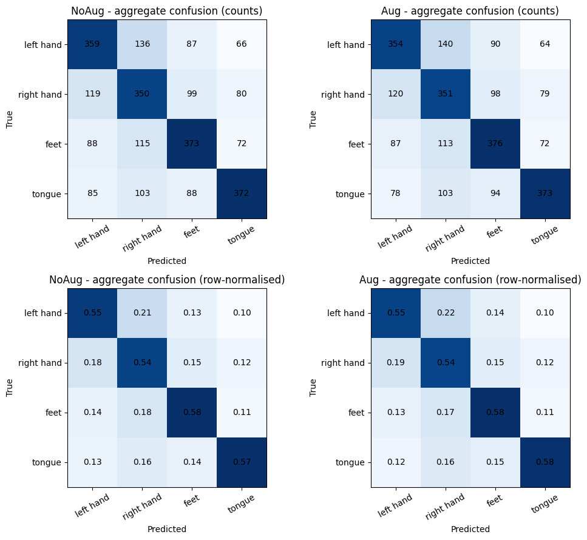

# Motor Imagery BCI: decoding  neural intentions across people and sessions

EEG motor-imagery decoding with **CSP–LDA, EEGNet, attention-based networks and Riemannian geometry**, using BCI Competition IV Dataset 2a. The project investigates two tasks: **binary left/right-hand classification** and **four-class decoding** of left hand, right hand, both feet and tongue imagery.

The central question is how decoding changes when the participant or recording session changes, not simply which experiment has the highest score.

## At a glance

- **Unseen participants:** four-class EEGNet reached **55.3% mean balanced accuracy** under nested LOSO across nine participants.
- **A new session of the same participant:** EEGNet reached **56.1% mean balanced accuracy**, with considerable participant variability.
- **Augmentation:** Gaussian noise at the tested setting produced no clear average improvement in either experiment.
- **Interpretability:** removing 8–12 Hz content impaired cross-session decoding more than the specified control bands in **four of nine participants**. General dependence on beta activity or specific reliance on C3/Cz/C4 was not established.

These are offline, exploratory evaluations on an existing dataset. They do not establish a prospective online BCI, clinical validity or an independent external validation.

## A cognitive neuroscience perspective

My background in **Cognitive Neuroscience** shaped the distinction between decoding performance and physiological interpretation. I inspect spatial patterns, frequency sensitivity and ERD/ERS to investigate whether predictions are compatible with sensorimotor EEG activity, while keeping model reliance separate from neural source localization.

Scalp topographies and perturbation effects provide descriptive evidence; they do not prove that a decoder has isolated a particular cortical generator.

## Evaluation design

| Setting | What is held out? | What does it assess? |
|---|---|---|
| Within-subject binary CSP–LDA | Trials from the same participant | New trials from a represented participant |
| Fixed subject holdout | Two participants | Transfer to that particular unseen pair |
| Nested LOSO EEGNet | One participant at a time, with grouped inner validation | Transfer across nine participants |
| Cross-session EEGNet | Session E; training/validation use T of the same participant | Session transfer within a represented person |
| Transductive Riemannian adaptation | Target labels, but not all target signals | Transfer with explicitly available unlabeled target data |

These settings answer different questions and are **not a single leaderboard**. The nominal uniform chance level is 50% for the binary task and 25% for the four-class task; these are reference levels, not significance tests.

## Headline results

Values below are means ± **between-participant standard deviations**, not confidence intervals.

| Experiment | Condition | Balanced accuracy | Macro F1 |
|---|---|---:|---:|
| EEGNet nested LOSO | NoAug | **55.3% ± 9.0%** | 0.540 ± 0.097 |
| EEGNet nested LOSO | Gaussian augmentation | 55.3% ± 8.5% | 0.542 ± 0.088 |
| EEGNet cross-session | NoAug | **56.1% ± 13.6%** | 0.557 ± 0.136 |
| EEGNet cross-session | Gaussian augmentation | 56.1% ± 13.4% | 0.557 ± 0.133 |

Nested LOSO uses nine outer test participants and three-fold participant-grouped inner validation. Cross-session evaluation trains on session-T runs 0–4, selects checkpoints on run 5 and tests on session E. Its default preprocessing uses each session's unlabeled EOG-calibration recordings for ICA; it is not transfer without test-session calibration.

Gaussian noise uses σ = 0.05 and a 0.5 application probability in these experiments, on their respective normalized inputs. Similar rounded averages do not establish equivalence or imply that augmentation never helps.

*Saved output from notebook 11.1. Each matrix contains 2,592 test trials across nine participants. Pooled confusion matrices and participant-mean metrics are different summaries.*

Additional experiments include **65.7% ± 8.4% within-subject binary accuracy**, a fixed-pair EEGNet holdout result of **47.0% accuracy**, and Riemannian baselines near **26–28% balanced accuracy**, rising to approximately **31–34%** with the tested target-adaptation methods. These results remain specific to their preprocessing and evaluation assumptions. [Detailed methods and results](docs/METHODS_AND_RESULTS.md)

## What the models use

The cross-session interpretation notebook loads frozen checkpoints and checks their predictions against the saved experiment before performing:

- Mu, beta and combined-band removal, with control-frequency perturbations.
- Channel occlusion, anatomical controls and equal-size random channel subsets.
- Descriptive ERD/ERS analysis, separately from model sensitivity.
- Class-specific confusion analysis.

The strongest spectral result is **participant-dependent reliance on mu-band content**, rather than a general demonstration that EEGNet decodes motor-cortex mu/beta rhythms. Band removal also changes the input distribution, and its effects cannot be interpreted as causal brain mechanisms. A variance-preserving variant was added post hoc and is reported separately.

## Offline demonstrations

- [Binary interface simulation](https://lidiascudiero-demo-2-class-bci.hf.space): illustrates trial playback and CSP visualization. In the supplied script, arrows follow recorded labels and confidence values are simulated; this is **not classifier inference**.
- [Four-class replay application](https://lidiascudiero-demo-4-class-bci.hf.space): the supplied implementation loads EEGNet and performs inference on a simulated LSL stream of preprocessed A07T data. This demonstrates software integration, not prospective online or unseen-person validation.

The descriptions above refer to the supplied code; hosted deployments can differ. Replay performance is not substituted for the benchmark results.

## Reproducing the analyses

Download the data separately from the [official competition distribution](https://www.bbci.de/competition/iv/download/) or [BNCI dataset catalogue](https://bnci-horizon-2020.eu/database/data-sets). Dataset 2a contains nine participants, two sessions, 22 EEG and three EOG channels. Follow the original data terms and citation requirements.

Choose the experiment branch before execution: historical notebooks use MATLAB/session-T inputs; the revised cross-session branch uses GDF files, evaluation labels and calibration provenance. Directory and file conventions are defined in each notebook; there is no single shared configuration covering all experiments.

See the [notebook guide](docs/NOTEBOOK_GUIDE.md) for execution dependencies and the [publication review notes](docs/PUBLICATION_REVIEW.md) for limitations identified from the supplied files. Results were checked against embedded notebook outputs; the complete training workflows were not rerun for this documentation update.

**Stack:** MNE-Python, NumPy, SciPy, pandas, scikit-learn, TensorFlow/Keras, PyTorch/Braindecode, pyRiemann, Matplotlib, Streamlit and PyLSL.

## Limitations

- Nine participants from one dataset, limited training-seed replication and substantial individual variability.
- Historical and revised preprocessing differ; early whole-recording ICA does not establish strict inductive preprocessing.
- Earlier channel naming and CSP input channels require audit before physiological claims or a standardized rerun.
- Offline filtering, trial structure and normalization are not evidence of streaming equivalence.
- Interpretability is exploratory; channel mixtures, perturbation-induced distribution shift and residual artifacts constrain conclusions.
- No prospective acquisition, closed-loop user study, assistive-device validation or clinical evaluation was performed.

## References and acknowledgements

This is an independent analysis. Data collection and original methods belong to their respective authors.

- **Brunner, C., Leeb, R., Müller-Putz, G. R., Schlögl, A., & Pfurtscheller, G.** BCI Competition 2008—Graz data set A. [Official Dataset 2a description](https://www.bbci.de/competition/iv/desc_2a.pdf).
- **Tangermann, M., et al. (2012).** Review of the BCI Competition IV. *Frontiers in Neuroscience*, 6, 55. [Paper](https://doi.org/10.3389/fnins.2012.00055).
- **Lawhern, V. J., et al. (2018).** EEGNet: a compact convolutional neural network for EEG-based brain-computer interfaces. *Journal of Neural Engineering*, 15, 056013. [Paper](https://doi.org/10.1088/1741-2552/aace8c).

The implemented models and protocols are not claimed to reproduce the original competition or architecture-paper benchmarks exactly.
